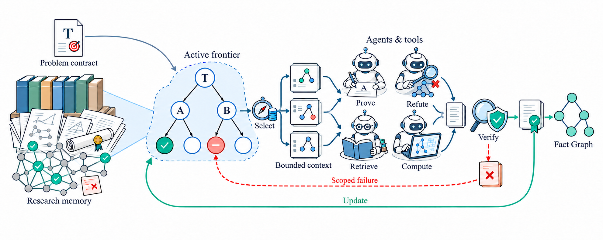

<div align="center">

#  Euler

Euler 是一个帮助研究者理解和把握完整推导过程的数学研究智能体系统。团队成员共享结构化研究状态，让推导可供检查，并以此支持模型推理与团队协作。

[](https://github.com/canghaimeng/Euler/actions/workflows/ci.yml)
[](pyproject.toml)
[](docs/CLI-SUPPORT.zh.md)
[](LICENSING.zh.md)

[English](README.md) · **简体中文**

[核心贡献](#核心贡献) · [数学成果](#数学成果) · [快速开始](#快速开始) · [使用指南](docs/DASHBOARD-GUIDE.zh.md) · [架构](ARCHITECTURE.zh.md) · [CLI 支持](docs/CLI-SUPPORT.zh.md) · [许可](#许可) · [讨论社群](#讨论社群)

</div>

## 🚀 News

- 🎉 **[Lewis–Overton（2008）](examples/lewis-overton/README.zh.md)** — 由纽约大学 Silver Professor Michael Overton 与康奈尔大学教授 Adrian Lewis 提出的猜想，两位提出者均为 SIAM Fellow，并已审阅我们针对该猜想的论证，确认了其正确性。
- 🎉 **[Nikoghosyan（2013）](examples/nikoghosyan/README.zh.md)** — 解决 Hamilton 图论中一个历时 13 年的开放问题，补齐 1-tough 图的单一禁用诱导子图 Hamilton 性分类。
- 🎉 **[Jankiewicz–Norin–Wise（2017）](examples/jnw/README.zh.md)** — 由几何群论学者共同提出的问题，提出者之一 Daniel Wise 是 James McGill Professor、英国皇家学会会士。

<p align="center">
  
</p>

数学研究产生的知识远超最终证明：命题逐步精确，路线被提出或放弃，引理形成依赖，验证给出通过或失败的依据。Euler 将这些记录组织为**共享研究状态**，保存精确命题及其适用范围、目标与步骤、证明路线、依赖关系、失败尝试和每条记录所关联的证据。这一结构同时服务两方面。

- **帮助研究者把握完整推导过程。** 从主目标逐层查看单个步骤，了解每个结论依赖什么、路线为何受阻，以及还缺少哪些前提。团队运行时可以持续阅读；问题尚未解决时，也能理解已有积累。
- **为智能体团队提供共同的工作结构。** 围绕明确的待解义务规划任务，引用精确命题，并依据共同的目标和路线进行协作。这一表示旨在支持长期研究中的推理与协调。

研究者和智能体使用同一套记录。**研究前沿（Frontier）** 是其中当前活跃的部分，包括未闭合目标、正在探索的路线、障碍及相关证据，让双方明确研究进行到了哪里。

<a id="核心贡献"></a>
## 🧩 核心贡献

### 1. 🕸️ 用层级关系图看清推理逻辑

Euler 用**层级关系图**展示从前提到结论的推理逻辑。点击图中的任意命题，就能沿已记录的关系向前追溯**它依赖哪些前提**，向后查看**它支持哪些后续结论**，并展开相应步骤的证明与依据。图中突出主结论的推导路线，标明已完成、待证明和受阻的环节；研究推进时同步更新，让研究者一眼看清整体证明结构和当前进度，再深入查看感兴趣的部分。[查看三个公开案例 →](https://canghaimeng.site/euler/cases/?lang=zh)

### 2. 🚩 可回溯、可追问、可分支的团队里程碑

Euler 支持研究者**回到任意已保存的团队研究里程碑**，恢复当时的项目文件、研究图谱、证据及受支持的成员原生会话。研究者可以从 Graph 节点选择关联的里程碑，将已保存的团队状态恢复到独立工作区，直接向成员追问当时记录的研究思路与数学原理、检查存疑步骤，或从该处探索新的研究方向。原始研究与新分支分别保留，便于继续追踪和比较。[了解团队恢复机制 →](docs/TEAM-RECOVERY.zh.md)

### 3. 🧱 以结构化表征支持更强的长程数学推理

Euler 将**结构化研究状态**作为团队规划、上下文检索、协作和验证的持久基础。完整研究历史跨会话保存，每个任务按需获取相关命题、依赖、已有失败和验证依据，使研究能够跨越多个上下文窗口、通过可恢复的会话持续推进，并围绕明确的待解义务决定下一步。这一设计旨在通过知识积累、协同探索与独立核验增强数学推理能力，支持攻坚需要长期研究、超出单次模型回答能力的问题。同时，通过明确区分待验证的想法与已验收的结论、检查前提依赖并进行独立核验，针对单 Agent 长程推理中的幻觉与错误累积设置检查机制，减少未经证实的断言被继续当作前提使用的风险。[阅读系统架构 →](ARCHITECTURE.zh.md)

## ✨ 核心功能

| 功能 | 用途 |
| --- | --- |
| [**六个工作台视图**](docs/DASHBOARD-GUIDE.zh.md) | 概览、证明阅读、研究现场、关系图、运行诊断、团队交互；支持中英文界面。 |
| [**持续更新的研究图与事实图**](docs/DASHBOARD-GUIDE.zh.md) | 目标、路线、步骤形成研究图，已验收结论形成事实图；可以切换主线、前沿和全部记录。 |
| [**精确命题、范围与证据**](docs/DASHBOARD-GUIDE.zh.md) | 保存原始表述、适用范围、直接前提与验证依据；数学内容保留原文。 |
| [**以证据为依据的验收**](docs/DASHBOARD-GUIDE.zh.md) | 步骤在登记了满足项目要求的证据后闭合，例如独立证明检查或 Lean 内核检查。 |
| [**针对数学对象的追问**](docs/HUMAN-INTERVENTION.zh.md) | 对一个步骤发起带有精确命题和范围的追问；启用单项研究任务时，预览并确认后再执行。 |
| [**整个团队的研究里程碑**](docs/TEAM-RECOVERY.zh.md) | 将文件、图谱、证据及受支持的原生团队会话保存至私有 Git 历史，在独立分支中恢复并继续探索。 |
| [**多种 CLI，共用一个浏览器入口**](docs/CLI-SUPPORT.zh.md) | 在 Linux 或 macOS 上组合 Codex、Claude Code、Gemini CLI、Grok、Cursor Agent；在工作台中创建项目、添加成员并继续对话。 |

<a id="快速开始"></a>
## ⚡ 快速开始

> [!NOTE]
> 需要 **Python 3.10+** 与 **Git**。运行研究团队支持 **Linux**（Landlock ABI 3+）或 **macOS**。请从源代码仓库安装，以包含团队使用的约定与技能文件。

**本地流程演示（无需模型账号）。** 内置脚本以整数恒等式 `n + 0 = n` 为例，使用预设的证明文本和检查回复，经过 Euler 的任务调度、提交与验收记录流程，生成可在工作台查看的示例；另提供一个空白探索项目。运行时不调用模型、不消耗模型额度，适合检查安装和熟悉界面。要阅读真实研究案例，可直接打开[三个公开案例的可视化](https://canghaimeng.site/euler/cases/?lang=zh)。

```bash
git clone https://github.com/canghaimeng/Euler.git && cd Euler
python3 -m venv .venv && source .venv/bin/activate
python -m pip install -e '.[demo,observability]'
euler-dashboard-demo --port 8099        # 浏览器打开 http://127.0.0.1:8099
```

**启动自己的研究团队。** 安装并登录准备使用的 CLI，然后执行：

```bash
python -m pip install -e '.[gateway,observability]'
euler-team doctor                       # 检查 CLI 与系统隔离能力，不调用模型

mkdir -p ~/euler-research
cp examples/personal-research/research.json ~/euler-research/first.json
# 编辑 first.json：填写命题、适用范围、验收要求和团队配置
python examples/personal-research/create_workspace.py \
  --definition ~/euler-research/first.json --workspace ~/euler-research/first
```

初始化程序在本地执行，并打印后续两条命令：`euler-team prepare` 准备成员的原生会话，`start-workbench.sh` 在 <http://127.0.0.1:8130> 启动工作台。打开**团队交互**，选中负责人，发送第一条研究要求。

默认配置以欧几里得“素数有无穷多个”定理作为入门练习，由 Codex 负责协调、Grok 辅助研究；[`research.five-clis.json`](examples/personal-research/research.five-clis.json) 展示五种 CLI 的配置。新团队默认没有轮次或账户剩余额度百分比上限；可自行设置团队或成员的 `max_turns`，控制使用量。[使用指南](docs/DASHBOARD-GUIDE.zh.md) 介绍配置字段、SSH 远程访问和故障排查，也可连同仓库链接交给 coding agent，协助完成安装配置。

## 🔄 一个项目如何推进

1. **定义问题。** 记录精确命题、假设、目标类型、验收证据要求和团队配置。
2. **发起研究。** 用户向负责人提问，或由负责人安排成员任务；候选路线与步骤进入共享状态。
3. **理解过程。** 团队工作时视图持续更新；逐步展开前提与论证，观察研究前沿如何变化。
4. **验收结论。** 为步骤登记满足要求的证据，再更新闭合状态。
5. **恢复与分支。** 保存里程碑，在独立工作区恢复成员会话并调整研究方向，保留原项目。

从图中节点恢复团队时，选择该节点关联的已保存里程碑及相应的原生会话归档。

<a id="数学成果"></a>
## 📐 数学成果

**[在线阅读三个案例的可视化 →](https://canghaimeng.site/euler/cases/?lang=zh)**

公开展示提供项目切换、证明阅读、研究历史和交互式依赖图。可点击节点查看前提、推导及来源，或突出其证明路径。展示使用历史研究快照，团队调用、发送消息和恢复研究功能均已关闭。

### Lewis–Overton：初始化如何影响渐近速率

BFGS 是广泛使用的优化方法，其在非光滑问题上的行为仍有许多值得研究之处。Adrian Lewis 与 Michael Overton 于 2008 年提出一个猜想，预期收敛速率只由问题参数决定。同一目标函数的两种初始化，在一个开放参数区间内产生不同的精确 trial-normalized 渐近速率，表明即使在这个简单的一维模型中，初始化也会影响速率。

**[了解案例 →](examples/lewis-overton/README.zh.md)** · [可视化](https://canghaimeng.site/euler/cases/?project=lewis-overton&lang=zh) · [论文](examples/lewis-overton/paper.pdf) · [Lean 形式化](https://github.com/canghaimeng/lewis-overton-bfgs-rate)

### Nikoghosyan：补齐 Hamilton 性分类

Hamilton 圈恰好经过图的每个顶点一次。图的韧性与 Hamilton 性之间的关系自 20 世纪 70 年代起持续受到研究。Nikoghosyan 猜想的证明补齐了单一禁用诱导子图分类的最后一种情况：结合 Li–Broersma–Zhang 的已有结果，可以确定哪些禁用诱导子图条件使 1-toughness 足以保证 Hamilton 性。[分类背景](https://ris.utwente.nl/ws/files/253281133/Li2016forbidden.pdf)。

**[了解案例 →](examples/nikoghosyan/README.zh.md)** · [可视化](https://canghaimeng.site/euler/cases/?project=nikoghosyan&lang=zh) · [论文](examples/nikoghosyan/paper.pdf) · [Lean 形式化](https://github.com/canghaimeng/Nikoghosyan-conjecture)

### Jankiewicz–Norin–Wise：图与几何之间一种证书方法的边界

Legal systems 是研究直角 Coxeter 群时使用的组合证书。Jankiewicz、Norin 与 Wise 询问，是否存在满足强连通性与曲率条件，却在所有四连通普通子图中都没有 legal system 的图。一个 33 顶点构造回答了这个四连通问题，说明该证书方法的适用边界。更强的三连通变体是另一个问题。

**[了解案例 →](examples/jnw/README.zh.md)** · [可视化](https://canghaimeng.site/euler/cases/?project=jnw&lang=zh) · [论文](examples/jnw/paper.pdf) · [Lean 形式化](https://github.com/canghaimeng/JNWLegalSystemObstruction)

## 📚 文档

| 文档 | 内容 |
| --- | --- |
| [使用指南](docs/DASHBOARD-GUIDE.zh.md) | 安装、首个项目、六个视图、里程碑、故障排查 |
| [CLI 支持](docs/CLI-SUPPORT.zh.md) | 服务商、系统隔离与原生会话恢复 |
| [团队恢复](docs/TEAM-RECOVERY.zh.md) · [研究里程碑](docs/RESEARCH-MILESTONES.zh.md) | 保存内容与恢复过程 |
| [研究干预](docs/HUMAN-INTERVENTION.zh.md) | 可选的独立单项研究任务 |
| [架构](ARCHITECTURE.zh.md) · [安全与信任](docs/security-and-trust.zh.md) | 系统分层、约束、接口和信任边界 |

[案例索引](examples/README.zh.md) 列出收录的论文版本及独立 Lean 仓库。案例页面说明了这些研究在不同历史工作流版本中的发展过程。

## 🛠️ 开发

```bash
python -m pip install -e '.[dev]'
python -m pytest euler/ -q
```

测试离线运行，使用本地协议模拟程序代替服务商 CLI。CI 覆盖 Python 3.10 和 3.13，并在真实浏览器中检查打包后的工作台。提交改动前请阅读 [贡献指南](CONTRIBUTING.zh.md)。

## 👥 作者与引用

| 作者 | 单位 |
| --- | --- |
| [Qiuyu Chen](https://github.com/canghaimeng) | Shanghai Jiao Tong University |
| [Qi Wang](https://qiwang067.github.io/) | Institute of Automation, Chinese Academy of Sciences |
| [Liang Xu](https://liangxuy.github.io/) | Zhongguancun Academy, Beijing, China |
| [Xin Jin](https://jinx-ustc.github.io/jinxin.github.io/) | Eastern Institute of Technology, Zhejiang, China |
| [Baao Xie](https://openreview.net/profile?id=~Baao_Xie3) | Ningbo Institute of Digital Twin, Eastern Institute of Technology, Zhejiang, China |
| [Wenjun Zeng](https://www.eitech.edu.cn/en/2025/0721/c606a2753/page.htm) | Eastern Institute of Technology, Zhejiang, China |

引用 Euler 请使用 [CITATION.cff](CITATION.cff)。

```bibtex
@software{euler2026,
  title        = {Euler: Human-Centered Mathematical Research with Frontier-Driven Agents},
  author       = {Chen, Qiuyu and Wang, Qi and Xu, Liang and Jin, Xin and Xie, Baao and Zeng, Wenjun},
  year         = {2026},
  version      = {0.3.0.dev0},
  url          = {https://github.com/canghaimeng/Euler},
  institution  = {Shanghai Jiao Tong University; Institute of Automation, Chinese Academy of Sciences; Zhongguancun Academy, Beijing, China; Eastern Institute of Technology, Zhejiang, China; Ningbo Institute of Digital Twin, Eastern Institute of Technology, Zhejiang, China}
}
```

<a id="许可"></a>
## 📄 许可

Euler 的原创工作与修改采用 **[PolyForm Noncommercial License 1.0.0](LICENSE)**，允许在协议条款下进行非商业使用、修改和再分发。所包含代码、库和论文的许可见[许可说明](LICENSING.zh.md)。

## 🙏 致谢

Euler 的图结构设计参考了 [Danus](https://github.com/frenzymath/Danus)，开发中查阅了 [Rethlas](https://github.com/frenzymath/Rethlas) 的实现。感谢这两个项目的作者与贡献者分享他们的工作。

感谢 Michael Overton 教授和 Adrian Lewis 教授投入时间，仔细审阅我们针对 Lewis–Overton 猜想的论证，并确认其正确性。

<a id="讨论社群"></a>
## 💬 讨论社群

欢迎加入社群，交流数学研究与 Euler 使用经验，提出问题和改进建议。

<table>
  <tr>
    <th align="center">Discord 社区</th>
    <th align="center">微信交流群</th>
  </tr>
  <tr>
    <td align="center" valign="middle"><a href="https://discord.gg/gPmE4kzqC"></a></td>
    <td align="center" valign="middle"><a href="docs/assets/wechat-community.png"></a></td>
  </tr>
  <tr>
    <td align="center"><a href="https://discord.gg/gPmE4kzqC">点击加入 Discord</a>，也可扫码加入</td>
    <td align="center">使用微信扫码加入 · 有效期至 10 月 19 日</td>
  </tr>
</table>
